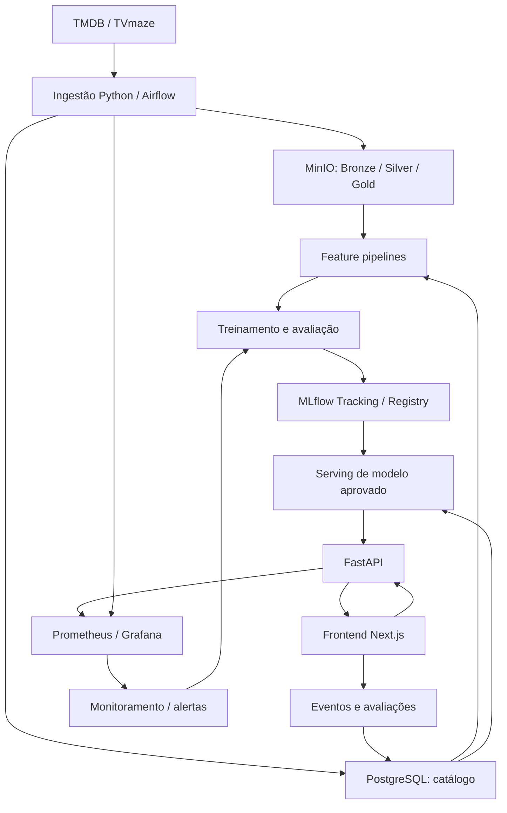

# CineMatch — Especificação técnica e plano de execução para Codex / Claude

> **Papel do agente:** atuar como arquiteto de software, engenheiro de dados, cientista de dados e engenheiro de MLOps. Implementar incrementalmente, com testes, documentação e decisões justificadas. **Não tentar construir todo o sistema de uma vez.**
>
> **Objetivo:** criar do zero uma plataforma de recomendação de filmes e séries com catálogo coletado de fontes externas autorizadas, interações reais geradas pela aplicação, modelos comparáveis e pipeline completo de MLOps até produção.
>
> **Restrições:** priorizar ferramentas open source e baixo custo; não usar MovieLens ou bases prontas de interações; não inventar usuários, avaliações ou métricas de produção; respeitar termos, licenças, rate limits e atribuições das fontes; não contornar bloqueios de scraping.

## 1. Instruções operacionais para o agente

1. Antes de codificar, inspecione o repositório existente e descreva o estado atual. Se estiver vazio, proponha a estrutura mínima.
2. Produza `docs/IMPLEMENTATION_PLAN.md` com fases, dependências, decisões, critérios de aceite e riscos. Produza `docs/DECISIONS.md` com ADRs curtas.
3. Comece **somente pela Fase 0 e Fase 1**. Apresente arquivos que pretende criar/alterar, comandos e critérios de verificação; implemente em pequenos lotes verificáveis.
4. Não substitua configurações ou arquivos existentes sem verificar seu propósito. Não inclua segredos em código, logs ou commits.
5. Escreva código legível, tipado quando razoável, com tratamento de erros, logs estruturados e testes. Use `pyproject.toml`, Ruff e Pytest.
6. Após cada etapa, execute os testes disponíveis e reporte: o que foi feito, comandos executados, resultados, limitações e próxima etapa. Não declare testes como executados se não foram.
7. Não adicione Kubernetes, Kafka, Feast, Qdrant ou microserviços sem necessidade demonstrada. Prefira Docker Compose, PostgreSQL/pgvector e arquitetura modular.
8. Se houver uma decisão com impacto significativo (licença de dados, custo, deploy, esquema de autenticação), apresente alternativas e recomende uma antes de implementá-la.
9. Sempre diferencie **meta**, **hipótese**, **resultado medido** e **funcionalidade implementada**.

## 2. Produto e escopo

**Nome:** CineMatch.

**Usuário final:** cria conta, seleciona filmes/séries de que gosta ou não gosta, busca títulos, avalia, adiciona favoritos e recebe recomendações explicáveis.

**Operador:** acompanha ingestão, qualidade de dados, experimentos, versões de modelos, latência, drift e saúde do sistema.

**Meta de catálogo:** 5 mil títulos no MVP; expansão progressiva para ~30 mil, sujeita à disponibilidade e às condições das fontes.

**Funcionalidades:**
- Catálogo pesquisável de filmes e séries, com filtros por gênero, ano e idioma.
- Página de detalhes, itens similares e recomendações personalizadas.
- Onboarding de preferências e registro de impressões, cliques, favoritos, avaliações e feedback explícito.
- Fallback de popularidade e recomendação por conteúdo para usuários novos ou falhas do serviço.
- Dashboard técnico e documentação de experimentos, com métricas reais.

**Fora do MVP:** streaming de vídeo, scraping de sites restritos, recomendação em tempo real por streaming de eventos, infraestrutura distribuída complexa, cobrança e modelos colaborativos sem interações suficientes.

## 3. Fontes de dados e governança

| Fonte | Uso | Estratégia |
|---|---|---|
| TMDB | Catálogo principal: títulos, sinopses, gêneros, créditos, popularidade, avaliações agregadas | API oficial: https://developer.themoviedb.org/docs/getting-started |
| TVmaze | Complemento para séries e episódios | API pública: https://www.tvmaze.com/api |
| CineMatch | Eventos, avaliações, favoritos, impressões e preferências | Coleta first-party, consentimento e política de privacidade |

**Regras obrigatórias:** verificar documentação e termos atuais antes da coleta; respeitar limites, licenças, atribuição e requisitos de uso de imagens; manter proveniência (`source`, `external_id`, `fetched_at`, `license_notes`); preferir APIs ao scraping HTML; usar Scrapy apenas para fontes com coleta permitida. Não confundir avaliações agregadas externas com avaliações individuais de usuários. Não usar dados de interações fabricados para alegar qualidade real de modelos.

### Pipeline de ingestão

1. Descoberta paginada de IDs por fonte.
2. Extração com retries limitados, backoff exponencial, timeout, tratamento de 429 e checkpoints.
3. Armazenamento Bronze de respostas brutas JSON/JSONL comprimidas em MinIO, com `run_id` e timestamps.
4. Transformação Silver: normalização, tipos, integridade, deduplicação, IDs externos e valores ausentes.
5. Gold: tabelas e snapshots de features/datasets para treinamento.
6. Cargas incrementais idempotentes com upsert e controle de última atualização.
7. Qualidade: unicidade, não nulidade de chaves, integridade referencial, cobertura de campos, contagem de registros e monitoramento de alterações de schema.

**Não assumir que IDs de diferentes fontes são equivalentes.** Usar IDs externos verificados; correspondência aproximada por título/ano só com regras e sinalização de incerteza.

## 4. Arquitetura de referência



**Stack inicial:** Python 3.12+, HTTPX, Pydantic, SQLAlchemy/Alembic, PostgreSQL com pgvector, MinIO/Parquet, Airflow, scikit-learn, Sentence Transformers, MLflow, FastAPI, Next.js, Docker Compose, GitHub Actions, Pytest e Ruff. Redis apenas se cache for necessário. Evidently, Prometheus e Grafana em fases posteriores.

**Princípios:** separação entre treino e inferência; configurações por ambiente; migrações de banco; artefatos versionados; possibilidade de rollback; observabilidade; mínimo custo operacional.

## 5. Modelo de dados inicial

Tabelas sugeridas (refinar por migrações Alembic):

- `catalog_items`: ID interno, tipo (movie/tv), título, título original, sinopse, ano, idioma, duração, status, popularidade, nota agregada, número de votos, timestamps.
- `item_external_ids`: ID interno, fonte, ID externo, data da última sincronização, UNIQUE(fonte, ID externo).
- `genres`, `item_genres`, `people`, `item_credits`, `item_keywords`.
- `item_embeddings`: item_id, embedding_model_version, vector, content_hash, created_at.
- `users`, `user_preferences`, `user_ratings`, `user_favorites`.
- `user_events`: event_id, user_id, item_id, event_type, event_timestamp, session_id, request_id, model_version, metadata.
- `recommendation_impressions`: request_id, user_id, item_id, rank, model_version, displayed_at, experiment_variant.
- `training_datasets`, `model_versions`, `experiment_assignments` (metadados e rastreabilidade, sem duplicar desnecessariamente o Registry).

**Eventos:** `impression`, `click`, `detail_view`, `favorite_add`, `favorite_remove`, `rating`, `dismiss`. Validar payloads e deduplicar por event_id. Uma ausência de clique **não** é automaticamente uma avaliação negativa; impressões precisam ser registradas para definir exposição.

**Privacidade:** minimização de PII, consentimento quando aplicável, exclusão de conta e dados, retenção definida, autenticação e autorização, proteção contra abuso de endpoints e cuidado com LGPD.

## 6. Features e prevenção de leakage

**Item:** gêneros, palavras-chave, sinopse, elenco, ano, idioma, popularidade calculada em snapshot temporal, embeddings e disponibilidade de metadados.

**Usuário:** preferências explícitas, distribuição histórica de gêneros, avaliações anteriores, afinidades e embedding agregado, sempre calculados com dados anteriores ao momento da recomendação.

**Contexto:** sessão, horário, dispositivo quando pertinente, posição e versão do modelo.

**Dataset de treinamento:** snapshots versionados, cutoff temporal explícito, janela de observação e janela de rótulos, IDs estáveis e filtros documentados. Não utilizar features produzidas com informação futura. Versionar código de featurização, modelo de embeddings, texto de entrada e índices vetoriais.

## 7. Roadmap de modelos

| Etapa | Modelos | Pré-requisito |
|---|---|---|
| A — Baselines | Popularidade, popularidade recente, média bayesiana | Catálogo |
| B — Content-based | TF-IDF + cosseno; embeddings + cosseno | Sinopses/metadados |
| C — Colaborativo | ALS, BPR, LightFM | Interações reais suficientes |
| D — Neural | Two-Tower (PyTorch), opcional | Interações e infraestrutura adequadas |
| E — Híbrido | Candidate fusion + LightGBM Ranker | Dados históricos de exposição e resultados suficientes |

**MVP:** recomendar itens similares por TF-IDF e embeddings, comparar resultados e disponibilizar `GET /movies/{id}/similar`. Para personalização inicial, combinar os itens explicitamente preferidos pelo usuário e aplicar regras de diversidade.

**Arquitetura futura retrieval + ranking:** recuperar candidatos de conteúdo, colaborativo e popularidade; unir/deduplicar; aplicar filtros; gerar features point-in-time; ranquear; reordenar por diversidade e novidade; registrar impressões e versão. Não treinar ranker supervisionado sem rótulos adequados.

## 8. Avaliação

**Offline:** divisão temporal train/validation/test, com conjuntos de candidatos consistentes; NDCG@10 como métrica primária de ranking, Recall@10, Precision@10, MAP@10, cobertura, diversidade, novidade e desempenho por segmento. Documentar elegibilidade, definição de relevância, amostragem negativa e intervalos de confiança quando apropriado. Para similaridade sem histórico, usar avaliações qualitativas e testes de sanidade, **não** alegar NDCG real.

**Online:** impressões, CTR, favoritos, avaliações positivas, retenção e latência. A/B testing somente com atribuição persistente, rastreamento de exposição e volume suficiente; não interpretar diferenças pequenas como estatisticamente significativas.

**Performance:** estabelecer orçamento inicial de latência p95 < 200 ms para endpoints de recomendação em condições de teste especificadas; medir antes de afirmar cumprimento.

## 9. MLOps

### DAGs previstas

- `catalog_ingestion` — coleta incremental diária (configurável).
- `feature_pipeline` — materialização de features e embeddings quando necessários.
- `model_training` — treinamento agendado ou por demanda, com snapshots reproduzíveis.
- `model_monitoring` — qualidade, distribuição, freshness e métricas online.

### MLflow

Registrar parâmetros, métricas, artefatos, hash Git, dataset snapshot, dependências, tempos e versão de features. Usar Model Registry e aliases `champion` / `challenger`. Comparar challenger com champion antes da promoção; preservar versão anterior para rollback.

### CI/CD/CT

- **CI:** Ruff, Pytest, testes de contrato, migrações, integração e build.
- **CD:** build de imagem, staging, smoke tests, deploy controlado, health checks e rollback.
- **CT:** treinamento independente do deploy de código; promoção condicionada a qualidade, compatibilidade, latência e validações.
- Não promover modelo automaticamente apenas por detectar drift.

### Observabilidade

Métricas de API (latência p50/p95/p99, erros, throughput), ingestão (falhas, freshness, contagens), features (nulos, mudança de distribuição), recomendação (coverage, CTR e qualidade com rótulos maduros), e operação (CPU/RAM). Dashboards, alertas e logs estruturados com IDs de correlação. Nunca registrar dados pessoais sensíveis em logs.

## 10. API e frontend

| Método | Rota | Função |
|---|---|---|
| GET | `/health` | Saúde básica |
| GET | `/movies` | Busca e filtros |
| GET | `/movies/{id}` | Detalhes |
| GET | `/movies/{id}/similar` | Similaridade por conteúdo |
| GET | `/recommendations/me` | Personalização autenticada |
| POST | `/ratings` | Avaliação explícita |
| POST | `/events` | Eventos validados e idempotentes |
| GET | `/users/me/preferences` | Preferências |
| GET | `/metrics` | Métricas com acesso apropriado |

Frontend: busca, filtros, detalhes, onboarding (ex.: 10 itens positivos e 5 negativos, sem obrigar o usuário a conhecer tantos), favoritos, avaliação, feed personalizado, estados vazios e fallback. Incluir atribuição de fontes conforme termos.

## 11. Estrutura sugerida

```text
cinematch/
├── apps/
│   ├── api/
│   └── web/
├── src/
│   └── cinematch/
│       ├── ingestion/
│       ├── data/
│       ├── features/
│       ├── models/
│       ├── evaluation/
│       ├── serving/
│       └── monitoring/
├── dags/
├── configs/
├── infra/
├── migrations/
├── tests/
├── docs/
├── .github/workflows/
├── pyproject.toml
├── .env.example
├── docker-compose.yml
└── README.md
```

## 12. Fases e entregáveis

### Fase 0 — Planejamento e bootstrap (primeira execução)
- Inspecionar repositório e ambiente.
- Criar plano de implementação, ADRs, README, `.gitignore`, `.env.example` sem segredos, `pyproject.toml` e estrutura inicial.
- Criar aplicação FastAPI mínima com `/health`, logging, Ruff, Pytest e Dockerfile.
- Criar Docker Compose mínimo para API + PostgreSQL; adicionar serviços somente quando forem usados.
- **Aceite:** ambiente sobe com instruções reproduzíveis; testes e lint passam; endpoint responde.

### Fase 1 — Coleta e persistência (primeiro marco funcional de dados)
- Validar termos e autenticação do TMDB; implementar cliente HTTP robusto e paginação.
- Criar migrações e schema inicial de catálogo.
- Implementar coleta configurável de até 5 mil títulos, em lotes e com checkpoint, sem exceder limites.
- Persistir raw JSON com proveniência e normalizar registros em PostgreSQL.
- Implementar upsert idempotente, métricas e testes com mocks HTTP.
- **Aceite:** executar a coleta duas vezes não cria duplicatas; erros transitórios são tratados; dados têm fonte e timestamp; existe comando documentado de ingestão.

### Fase 2 — Data quality e features
- Integrar TVmaze com resolução de entidades cuidadosa.
- Implementar camadas Bronze/Silver/Gold, checks de qualidade e snapshots.
- Gerar TF-IDF e embeddings versionados; armazenar vetores em pgvector.
- **Aceite:** pipeline reproduzível, checks automatizados, embeddings consistentes com versão.

### Fase 3 — Primeiro recomendador e serving
- Baselines de popularidade e similaridade de conteúdo.
- Avaliação técnica e qualitativa; registrar experimentos no MLflow.
- Implementar `/movies/{id}/similar`, testes de contrato e latência.
- **Aceite:** recomendações determinísticas para versão fixa e fallback funcional.

### Fase 4 — Aplicação e coleta de interações
- Next.js, autenticação, onboarding, avaliações, favoritos e eventos.
- Registrar impressões com request_id, posição e model_version.
- **Aceite:** eventos rastreáveis, idempotentes e consistentes; fluxo de usuário ponta a ponta.

### Fase 5 — Colaborativo e ranking
- Avaliar suficiência de interações reais.
- Implementar ALS/BPR/LightFM, avaliação temporal e cold start.
- Implementar Two-Tower e LightGBM Ranker **somente se** houver dados adequados.
- **Aceite:** comparação reproduzível com baselines, sem leakage, com relatório de limitações.

### Fase 6 — MLOps de produção
- DAGs Airflow, Registry e aliases MLflow, CI/CD, staging, rollback e monitoramento.
- Retreinamento validado, dashboards, testes de carga, documentação e demo.
- **Aceite:** rastrear um dado da coleta à recomendação, reproduzir treinamento e demonstrar rollback.

**Estimativa orientativa:** 12 semanas para MVP robusto e evolução de MLOps, dependendo do tempo disponível e do volume de interações. Não prometer que modelos colaborativos terão dados suficientes nesse período.

## 13. Critérios globais de pronto

- [ ] Ingestão incremental e idempotente, com logs e checkpoints.
- [ ] Dados brutos e datasets de treino rastreáveis e versionados.
- [ ] Qualidade de dados e migrações testadas.
- [ ] Baselines e modelos de conteúdo reproduzíveis.
- [ ] Avaliação sem leakage e com métricas interpretadas corretamente.
- [ ] Eventos reais e impressões registrados de forma consistente.
- [ ] Modelo aprovado disponível por API com fallback.
- [ ] MLflow registra experimentos, artefatos e versões.
- [ ] CI/CD e rollback demonstrados.
- [ ] Monitoramento de infraestrutura, dados e modelos.
- [ ] Segurança básica, privacidade, atribuições e licenças documentadas.
- [ ] README com setup, arquitetura, comandos, limitações e resultados medidos.

## 14. Primeira tarefa — execute agora

**Tarefa do agente:**

1. Examine o diretório atual e identifique se já existe código.
2. Explique, em até 15 linhas, a arquitetura mínima que pretende implementar e os principais trade-offs.
3. Crie `docs/IMPLEMENTATION_PLAN.md` com subtarefas para as Fases 0 e 1 e critérios verificáveis.
4. Implemente a Fase 0, mantendo mudanças pequenas e executando os testes.
5. Ao final, apresente resumo de arquivos criados, comandos para subir a aplicação, testes efetivamente executados e próximos passos da Fase 1.
6. **Não comece a Fase 2 nem treine modelos nesta primeira execução.**

Se faltar uma credencial do TMDB, use `.env.example` e mocks nos testes; não solicite que a chave seja colada em arquivos versionados. Não execute extrações grandes sem confirmar limites e configuração.
