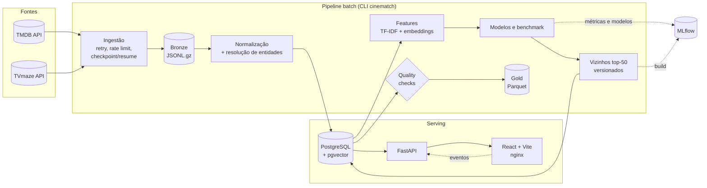

# CineMatch

**Recomendador de filmes e séries de ponta a ponta:** coleta de dados públicos, qualidade e versionamento, comparação de modelos com MLflow, serving com FastAPI e um app web em React.

[](https://github.com/felipesembay/CineMatch/actions/workflows/ci.yml)


| | |
|---|---|
| **Catálogo** | 12.497 títulos (9.997 filmes, 2.500 séries), 94 mil pessoas, 19,5 mil keywords |
| **Modelos comparados** | TF-IDF, Sentence Transformers, RRF, Rocchio, LogisticRegression, SGD, LightGBM (LambdaRank) |
| **Em produção** | similares por TF-IDF (vizinhos pré-computados) + recomendação personalizada por Rocchio |
| **Latência** | `/movies/{id}/similar`: p95 18,8 ms (local, 1 cliente) |
| **Qualidade** | 159 testes (unitários + integração com Postgres), lint e build no CI |

---

## Sumário

- [O que o app faz](#o-que-o-app-faz)
- [Arquitetura](#arquitetura)
- [Dados](#dados)
- [Modelos](#modelos)
- [Resultados](#resultados)
- [Serving e personalização](#serving-e-personalização)
- [MLOps](#mlops)
- [Como rodar](#como-rodar)
- [Estrutura do repositório](#estrutura-do-repositório)
- [Limitações e próximos passos](#limitações-e-próximos-passos)
- [Fontes de dados, atribuição e licença](#fontes-de-dados-atribuição-e-licença)

## O que o app faz

- **Home:** destaque, "Em alta", "Mais bem avaliados" (média bayesiana) e fileiras por gênero.
- **Detalhe:** sinopse, elenco, direção e "Mais títulos como este", com o motivo de cada recomendação ("Da coleção…", "Direção de…", "Com…").
- **Busca:** por título, com filtros de tipo, gênero, ano e ordenação.
- **Onboarding:** gêneros favoritos e 👍 / 👎 em títulos conhecidos, sem exigir um número mínimo.
- **Minha lista:**
  - "Achamos que você vai gostar", gerado a partir do que você curtiu, favoritou e avaliou.
  - Abas de favoritos, avaliados e comentados, e curtidos.
- **Conta:** cadastro com e-mail ou **login com Google**, avaliação de 1 a 5 com comentário e exclusão da conta com todos os dados (LGPD).

## Arquitetura



- **Monólito modular em Python**, sem microsserviços. Tudo roda com `docker compose up`: Postgres com pgvector, API, frontend e MLflow.
- **O modelo não roda na requisição.** Jobs batch gravam as listas de vizinhos no Postgres com uma `model_version`. A API só lê essas listas, então a imagem não carrega scikit-learn/torch, a resposta é determinística e o rollback é um comando (`recs activate`).
- **Frontend e API na mesma origem:** o proxy `/api` fica no Vite em dev e no nginx em produção. Assim o cookie de sessão é first-party e não há CORS.

## Dados

| Etapa | Como |
|---|---|
| **Coleta TMDB** | Discover por popularidade e detalhe com `credits`, `keywords` e `external_ids`. Rate limit de 4 req/s, retry com `Retry-After`, checkpoint por item, retomada (`--resume`), lock por fonte. |
| **Coleta TVmaze** | Varredura do índice (91.004 shows), 1 req/s, CC BY-SA 4.0. |
| **Bronze** | Resposta bruta em JSONL.gz com proveniência (`run_id`, URI, data). Permite reprocessar tudo sem chamar a API (`cinematch reprocess tmdb`). |
| **Normalização** | Catálogo, gêneros, keywords e créditos com minimização (elenco < 15, equipe-chave, sem gênero da pessoa). Upsert idempotente por hash de conteúdo. |
| **Resolução de entidades** | TVmaze ↔ catálogo **só por IDs verificados** (IMDb/TVDB), com detecção de ambiguidade: 82,5% das séries ligadas, 0 ligações por similaridade de título. |
| **Qualidade** | 28 checks (chaves, cobertura por tipo, frescor, queda de contagem, schema drift do Bronze, consistência dos embeddings) com histórico. Um check em falha bloqueia o snapshot Gold. |
| **Gold** | Snapshots Parquet imutáveis com hash de conteúdo, manifesto e versões. Mesmo conteúdo, mesmo snapshot. |
| **Retenção** | Os termos do TMDB pedem cache de no máximo 6 meses. `tmdb-refresh` renova os itens mais antigos e `catalog expire` remove o que passou do prazo. Itens com dados de usuário viram *tombstone* em vez de serem apagados. |

Cobertura atual: pôster em 99,6% dos filmes e 97,9% das séries; sinopse em 99,5% e 92,6%; 2.832 filmes pertencem a uma coleção (franquia).

## Modelos

Todos usam o mesmo texto por item: título, sinopse, gêneros, keywords, direção e elenco principal.

| Modelo | Ideia | Detalhes |
|---|---|---|
| **TF-IDF + cosseno** (baseline) | Similaridade lexical e de metadados | Unigramas e bigramas, `sublinear_tf`, tokens prefixados para gênero, keyword e pessoa (`person_christopher_nolan`), 50 mil termos |
| **Sentence Transformers + cosseno** | Similaridade semântica da sinopse | `paraphrase-multilingual-MiniLM-L12-v2` (384 d, multilíngue: o app é em PT, os dados em EN), pesos fixados por commit do Hugging Face. Duas versões de texto: com título (`v1`) e sem título (`v2`) |
| **RRF** | Fusão de ranks TF-IDF + embeddings | Reciprocal Rank Fusion, `c = 60` |
| **Rocchio** | Expandir a consulta com feedback | PRF item → item: `q' = q + β·média(top-m)`. Perfil: `p = média(curtidos) − γ·média(não curtidos)` |
| **Rerankers supervisionados** | Aprender a ordenar candidatos | Candidatos = top-50 TF-IDF ∪ top-50 embeddings (1,16 milhão de pares). 14 features (cossenos, ranks, Jaccard de gêneros e keywords, pessoas em comum, tipo, idioma, distância de ano, popularidade), **sem features de título**. LogisticRegression, SGD (log-loss) e LightGBM LambdaRank. |

**Rótulo e validação.** Ainda não há interações de usuários, e a spec proíbe inventá-las. Por isso os modelos supervisionados aprendem um **rótulo fraco**: o candidato pertence à mesma coleção TMDB (franquia) da consulta.

A validação é GroupKFold por coleção: uma franquia nunca aparece no treino e no teste ao mesmo tempo. Todas as métricas abaixo são **proxies de coerência, não relevância para pessoas**. Detalhes em [ADR-017](docs/DECISIONS.md).

## Resultados

Benchmark de 2026-11-11 com 12.497 itens, top-10 e os mesmos itens para todos os métodos (`cinematch evaluate similarity-models`). Os testes de franquia usam 2.216 filmes cuja coleção tem 2 ou mais membros no catálogo.

| Método | Franquia: recall@10 | Franquia: nDCG@10 | Gênero em comum@10 | Palavra do título em comum@10 ↓ | Cobertura@10 | Hubness ↓ |
|---|---|---|---|---|---|---|
| TF-IDF | 0,942 | 0,896 | 0,810 | 0,130 | **0,997** | 0,072 |
| Embeddings v1 (com título) | 0,850 | 0,776 | 0,856 | 0,199 | 0,946 | 0,090 |
| Embeddings v2 (sem título) | 0,548 | 0,477 | 0,945 | **0,058** | 0,899 | 0,098 |
| RRF (TF-IDF + emb v2) | 0,804 | 0,714 | 0,930 | 0,098 | 0,966 | 0,065 |
| Rocchio PRF (TF-IDF) | 0,944 | 0,890 | 0,831 | 0,131 | 0,989 | 0,115 |
| Reranker LogisticRegression | 0,967 | 0,940 | 0,966 | 0,127 | 0,982 | 0,052 |
| Reranker SGD | 0,967 | 0,939 | 0,968 | 0,128 | 0,980 | 0,053 |
| **Reranker LightGBM** | **0,971** | **0,952** | **0,974** | 0,140 | 0,985 | **0,047** |

<sub>Hubness = fatia das recomendações ocupada pelo 1% de itens mais recomendados. IC 95% por bootstrap e recall por fold em [`docs/experiments/`](docs/experiments/).</sub>

**Recomendação a partir de vários títulos** (2 filmes curtidos de uma franquia → achar o restante; 313 tarefas):

| Estratégia | TF-IDF | Embeddings v2 |
|---|---|---|
| Só o primeiro título | 0,952 | 0,507 |
| MaxSim (máximo por título) | 0,959 | 0,560 |
| **Rocchio** (média dos vetores) | **0,972** | **0,611** |

**Leitura**

- **Rerankers:** melhoram ao mesmo tempo o proxy de franquia, a coerência de gênero e a hubness. O ganho em gênero e hubness é o mais informativo, porque o modelo não foi treinado nessas métricas.
  - LightGBM ≈ regressão logística (diferença dentro do IC). Por isso o challenger é a logística: mais simples e explicável.
  - Viés conhecido: como só filmes têm coleção, o modelo aprende "mesmo tipo" com peso alto.
- **Embeddings:** tirar o título reduz o atalho lexical (0,199 → 0,058 de palavra do título em comum) e melhora a coerência de tema, mas perde o sinal de franquia. TF-IDF e embeddings capturam noções diferentes de "parecido".
- **Rocchio de perfil:** supera um único título e MaxSim nas duas representações, por isso é a base do "Achamos que você vai gostar".

Histórico dos experimentos: [similaridade de conteúdo](docs/experiments/content_similarity_2026-11-10.md) e [modelos](docs/experiments/similarity_models_2026-11-10.md). Para explorar interativamente, use o notebook [`models/similarity_models.ipynb`](models/similarity_models.ipynb).

## Serving e personalização

| | Como funciona |
|---|---|
| **Similares** (`/movies/{id}/similar`) | Top-50 vizinhos do conjunto ativo (TF-IDF), no máximo 3 por coleção (diversidade), motivo por sobreposição de metadados, fallback bayesiano por gênero. Resposta com `model_version` e `request_id`. |
| **Para você** (`/recommendations/me`) | Rocchio no espaço de escores: `score(c) = Σ wₛ · sim(s, c)` sobre os vizinhos das sementes. Pesos: curtido e favorito +1, nota (n − 3)/2, não curtido −0,5. Exclui itens já vistos, no máximo 2 por coleção, motivo "Porque você curtiu X". Usuário novo recebe os mais bem avaliados dos gêneros escolhidos. |
| **Ranking "mais bem avaliados"** | Média bayesiana por tipo: `(v·R + m·C)/(v + m)`, com m = percentil 75 de votos. Títulos com poucos votos não dominam. |
| **Versões** | `recs build-similar` grava um conjunto de vizinhos versionado e registra o build no MLflow. `recs activate` troca o conjunto servido numa transação. O reranker fica gravado como challenger para teste A/B. |
| **Eventos** | `POST /events`: impressões (≥ 50% visível por ≥ 1 s), cliques, favoritos e buscas, idempotentes por `event_id`, com `request_id`, posição e `model_version` para atribuição de exposição. |
| **Segurança** | Login com Google (OAuth 2.0 + OpenID Connect com PKCE, `state` e `nonce`; ID token validado com as chaves públicas do Google). Senhas com Argon2id. Sessão opaca em cookie `httpOnly`/`SameSite=Lax`; o banco guarda só o hash do token. Checagem de `Origin` (CSRF), limite de tentativas de login, CSP no nginx, exclusão de conta em cascata. |

Latência medida em 2026-11-11 no container da API (1 cliente sequencial, 300 requisições por endpoint, Postgres local):

| Endpoint | p50 | p95 | p99 |
|---|---|---|---|
| `GET /movies/{id}/similar` | 11,7 ms | 18,8 ms | 26,7 ms |
| `GET /movies/{id}` | 8,0 ms | 9,6 ms | 10,5 ms |
| `GET /movies?q=…` (busca) | 16,9 ms | 22,2 ms | 25,6 ms |
| `GET /movies?sort=popular` | 20,1 ms | 23,9 ms | 48,7 ms |

A meta da especificação é p95 < 200 ms. A concorrência ainda não foi testada.

## MLOps

- **Reprodutibilidade:**
  - TF-IDF identificado pelo hash do corpus.
  - Embeddings versionados por `modelo@commit|versão_do_texto` e incrementais (só re-encoda texto alterado).
  - Snapshots Gold com hash de conteúdo.
  - `fingerprint` do conjunto de avaliação em cada run.
- **MLflow** (servidor próprio no Compose): os experimentos `similarity-item2item` e `serving-similar` guardam parâmetros, métricas, IC, importância de features e o modelo serializado. Runs com rótulo fraco recebem a tag `label_kind=weak:tmdb_collection`.
- **Qualidade como gate:** o `quality check` grava histórico, e um check em falha bloqueia o snapshot Gold.
- **CI (GitHub Actions):**
  - Backend: ruff, pytest com Postgres + pgvector e build da imagem.
  - Frontend: typecheck, build e imagem nginx.
- **Decisões documentadas:** 22 ADRs em [docs/DECISIONS.md](docs/DECISIONS.md), plano por fases com critérios de aceite em [docs/IMPLEMENTATION_PLAN.md](docs/IMPLEMENTATION_PLAN.md).

## Como rodar

Requisitos: Docker com Compose v2 e [uv](https://docs.astral.sh/uv/). Para o frontend em modo dev, Node 22.

```bash
git clone https://github.com/felipesembay/CineMatch.git && cd CineMatch
cp .env.example .env                        # defina POSTGRES_PASSWORD e TMDB_API_TOKEN
uv sync --extra ml
docker compose up -d --build postgres mlflow
uv run cinematch db upgrade

# dados (token TMDB gratuito: https://www.themoviedb.org/settings/api)
uv run cinematch ingest tmdb --types movie tv --max-items 500 --yes
uv run cinematch ingest tvmaze && uv run cinematch link tvmaze
uv run cinematch quality check

# features, modelos e vizinhos servidos
uv run cinematch features tfidf
uv run cinematch features embeddings --text-version emb_text_v2
uv run cinematch recs build-similar --method tfidf --activate --mlflow

docker compose up -d --build api web
```

| Serviço | URL |
|---|---|
| App | http://127.0.0.1:8088 |
| API (Swagger) | http://127.0.0.1:8010/docs |
| MLflow | http://127.0.0.1:5010 |

Todos os comandos (refresh, reprocessamento, Gold, benchmark, latência, testes de integração) estão em [docs/OPERATIONS.md](docs/OPERATIONS.md).

## Estrutura do repositório

```text
src/cinematch/
  ingestion/      clientes TMDB/TVmaze (retry, rate limit), Bronze, normalização, pipelines
  quality/        checks de qualidade com histórico
  features/       texto por item, TF-IDF, embeddings (pgvector)
  similarity/     modelos (cosseno, RRF, Rocchio, rerankers) e benchmark
  serving/        consultas de catálogo, popularidade bayesiana, vizinhos versionados
  users/          contas, sessões, interações, recomendação personalizada
  api/            FastAPI (catálogo, usuários, eventos, health)
  data/           schema SQLAlchemy e snapshots Gold
  tracking.py     integração com MLflow
  cli.py          comando `cinematch`
frontend/cinematch/   React + Vite + Tailwind + TanStack Query (Dockerfile com nginx)
models/               notebook de experimentos
migrations/           Alembic (8 migrações)
tests/                unitários e integração (Postgres real)
scripts/              migração do banco para outro PostgreSQL (ex.: Azure)
docs/                 plano, ADRs, fontes de dados, experimentos, operação
```

**Stack:** Python 3.12, uv, FastAPI, SQLAlchemy/Alembic, PostgreSQL 16 + pgvector, scikit-learn, Sentence Transformers (PyTorch CPU), LightGBM, MLflow, PyArrow, React 19, Vite, Tailwind, TanStack Query, Zod, nginx, Docker Compose, GitHub Actions, Ruff, Pytest.

## Limitações e próximos passos

- **Métricas offline são proxies.** A escolha entre TF-IDF e reranker deve sair de um teste A/B com CTR e favoritos, já instrumentado via eventos com `model_version`.
- **Filtragem colaborativa** (ALS/BPR) e ranking aprendido com interações reais só quando houver volume suficiente de usuários.
- **Nuvem:** migração completa do banco para Azure Database for PostgreSQL já automatizada e ensaiada (`scripts/migrate_db.sh`, [ADR-021](docs/DECISIONS.md)). Próximos: containers na nuvem, orquestração dos jobs batch (Airflow) e monitoramento (Prometheus/Grafana, drift).
- **Conta:** cadastro por senha sem verificação de e-mail nem recuperação de senha (o login com Google cobre esse caso); o limitador de login é em memória (uma réplica).
- **Termos do TMDB:** restringem o uso dos dados em ML. Este é um projeto de estudo, não comercial, com o risco registrado no [ADR-008](docs/DECISIONS.md).

## Fontes de dados, atribuição e licença

 This product uses the TMDB API but is not endorsed or certified by TMDB.

Dados de séries complementares de [TVmaze](https://www.tvmaze.com) ([CC BY-SA 4.0](https://creativecommons.org/licenses/by-sa/4.0/)). Termos, proveniência e retenção em [docs/DATA_SOURCES.md](docs/DATA_SOURCES.md).

Código sob a [licença MIT](LICENSE). Nenhum dado do TMDB/TVmaze é distribuído neste repositório.
